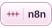
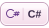

  <strong>AI stack</strong> 
  
  
  
  
  
  
  
  
  
  
  
  
  
  
  
  
  
  

  <strong>Development stack</strong> 
  
  
  
  
  
  
  
  
  
  
  
  
  
  
  
  

  <strong>✦ Mental Health stack ✦</strong> 
  
  
  

